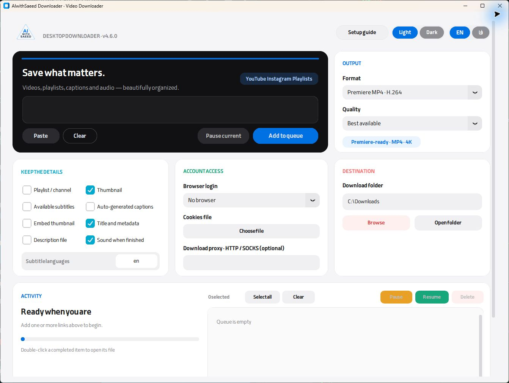

# AIwithSaeed Downloader

A Windows app for downloading video, audio, and subtitles. Includes a download queue, Premiere-compatible output, and Persian and English interfaces.

**[Download for Windows](https://github.com/rabbit2space/aiwithsaeed-downloader-public/releases/latest)** · [فارسی](README.md) · [AIwithSaeed](https://aiwithsaeed.com)

Windows 10/11 · x64 · Free · No account required

[](https://github.com/rabbit2space/aiwithsaeed-downloader-public/actions/workflows/tests.yml)



## Install and download

1. Open the download link above and choose the Windows **exe** installer.
2. Run it and click **شروع نصب** (“Start installation”). Setup downloads about 145 MiB of tools and installs them automatically.
3. Open the app, paste a video link, and click **Add to queue**. Use **Open folder** to find completed files.

To update, close the app and run the new installer. Your queue and settings are preserved. ZIP downloads contain source code.

## Features

- Single links, multiple links, and playlists with selectable quality
- Premiere-compatible video output and MP3 audio
- Subtitles, thumbnails, and media information
- Download progress and queue controls
- Automatic GPU encoding for Premiere output, with a CPU fallback
- Optional Firefox cookies and a personal Telegram bot

Site support comes from [yt-dlp](https://github.com/yt-dlp/yt-dlp). Downloads can be affected by changes to a site, account restrictions, or your network.

Video links stay single-video downloads even when they contain a playlist parameter. Enable **Playlist / channel** and confirm to download a whole collection. Old collection jobs require a scope choice before resuming.

**GPU encoding (auto)** is enabled by default for Premiere output. The app tests NVIDIA NVENC, Intel Quick Sync, and AMD AMF before using a CPU fallback. Compatible MP4 files skip conversion; compatible streams in other containers are remuxed. Decoding and audio processing can still use the CPU.

Deleting or pausing an active job stops its download and conversion processes before the queue proceeds. Interrupted jobs stay paused after restart; review them before resuming.

On the first launch of 4.7, existing pending items from older versions are also paused for review. Delete unwanted entries and resume only the downloads you intended.

## Optional setup

Try without cookies first. If YouTube asks you to sign in, open the app's setup guide for Firefox instructions. The same guide walks through creating a Telegram bot. The desktop app must stay open for the bot to work.

If your connection blocks installation or downloads, try another connection or a system-wide VPN. A browser VPN extension does not cover the desktop app.

The app connects to the source websites, optional Telegram services, and official tool download hosts. Keep cookies and tokens private; redact personal information before reporting an issue. Using account cookies can put that account at risk of restrictions.

## Develop and build

Install Python 3.11 or later, then run:

```powershell
.\run.bat
```

See the [technical reference](docs/REFERENCE.md) for tool requirements and Windows builds. The release build uses Python 3.14.

[Changelog](CHANGELOG.md) · [Contributing](CONTRIBUTING.md) · [Security](SECURITY.md) · [Third-party notices](THIRD-PARTY.md)

Original code is [MIT licensed](LICENSE); dependencies and fonts keep their own licenses. Download only media you are authorized to save.

Screenshots show the actual app using a fresh, empty profile. The Windows installer is unsigned.
