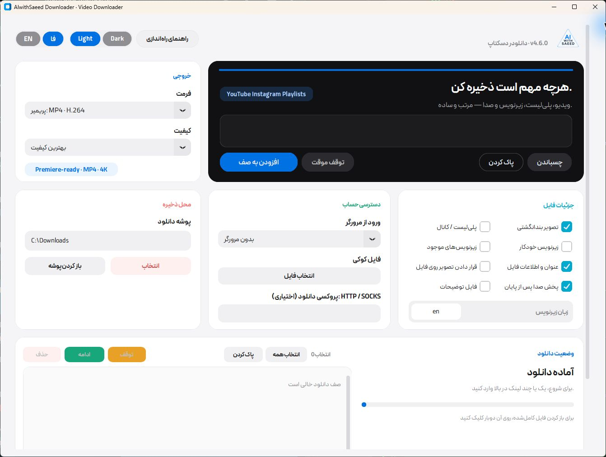
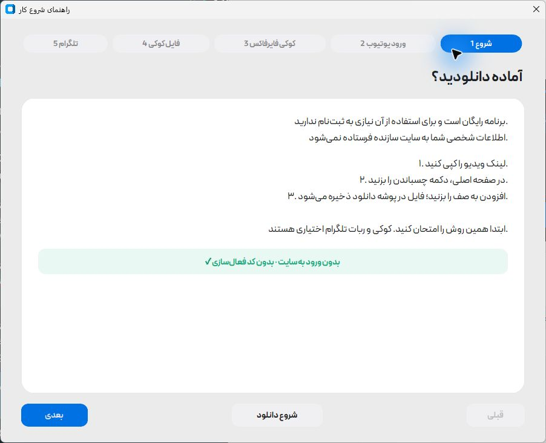

<div dir="rtl" align="right">


# دانلودر AIwithSaeed

دانلود ویدیو، صدا و زیرنویس برای ویندوز. با صف دانلود، خروجی مناسب پریمیر و رابط فارسی و انگلیسی.

**[دانلود برای ویندوز](https://github.com/rabbit2space/aiwithsaeed-downloader-public/releases/latest)** · [English](README.en.md) · [آموزش هوش مصنوعی](https://aiwithsaeed.com)

ویندوز ۱۰ و ۱۱ · نسخه ۶۴بیتی · رایگان · بدون ثبت‌نام

</div>

[](https://github.com/rabbit2space/aiwithsaeed-downloader-public/actions/workflows/tests.yml)



<div dir="rtl" align="right">

## از نصب تا اولین دانلود

۱. از لینک بالا، فایل نصب ویندوز با پسوند **exe** را بگیرید و باز کنید.

۲. «شروع نصب» را بزنید. حدود ۱۴۵ مگابایت ابزار دانلود می‌شود و نصب خودکار انجام می‌شود.

۳. برنامه را باز کنید، لینک ویدیو را بچسبانید و «افزودن به صف» را بزنید. فایل‌های آماده را با «باز کردن پوشه» پیدا می‌کنید.

اگر نسخه قبلی را دارید، برنامه را ببندید و فایل نصب جدید را اجرا کنید؛ صف دانلود و تنظیمات شما حفظ می‌شوند. فایل‌های ZIP بخش دانلود، سورس برنامه هستند.

## چه کارهایی می‌کند؟

- دانلود لینک تکی، چند لینک یا پلی‌لیست، با انتخاب کیفیت
- ذخیره ویدیو با خروجی مناسب پریمیر یا تبدیل به صدای MP3
- دریافت زیرنویس، تصویر کاور و اطلاعات ویدیو
- نمایش پیشرفت دانلود و کنترل صف
- استفاده اختیاری از کوکی فایرفاکس و ربات تلگرام شخصی

پشتیبانی از سایت‌ها به [yt-dlp](https://github.com/yt-dlp/yt-dlp) وابسته است. تغییر سایت مقصد یا محدودیت شبکه می‌تواند روی دانلود اثر بگذارد.

## کوکی، تلگرام و اتصال اینترنت

اول دانلود بدون کوکی را امتحان کنید. اگر یوتیوب ورود خواست، «راهنمای راه‌اندازی» داخل برنامه را باز کنید. همان راهنما مراحل فایرفاکس و ساخت ربات تلگرام را هم توضیح می‌دهد. برای کار کردن ربات، برنامه باید روی کامپیوتر باز بماند.

اگر اینترنت وصل است ولی نصب یا دانلود شروع نمی‌شود، اتصال دیگری یا فیلترشکن ویندوز را امتحان کنید. افزونه فیلترشکن مرورگر برای این برنامه کافی نیست.

</div>

<details>
<summary>نمای راهنمای شروع کار</summary>



</details>

<div dir="rtl" align="right">

## اطلاعات شخصی شما

برنامه لینک‌ها، کوکی، توکن تلگرام یا فایل‌های شما را به سایت AIwithSaeed نمی‌فرستد. برای دانلود به سایت مقصد، و در صورت استفاده از ربات، به تلگرام متصل می‌شود. ابزارهای نصب هم از منابع رسمی دریافت می‌شوند.

کوکی و توکن را برای کسی نفرستید. قبل از ثبت مشکل، اطلاعات شخصی را از تصویر و گزارش خطا حذف کنید. استفاده از کوکی حساب ممکن است باعث محدودیت آن حساب شود.

## برای توسعه‌دهندگان

پایتون ۳.۱۱ یا جدیدتر لازم است. فایل زیر محیط پایتون و وابستگی‌ها را آماده می‌کند و برنامه را اجرا می‌کند:

</div>

```powershell
.\run.bat
```

<div dir="rtl" align="right">

[راهنمای فنی و ساخت نسخه ویندوز](docs/REFERENCE.md) · [تغییرات نسخه‌ها](CHANGELOG.md) · [مشارکت](CONTRIBUTING.md) · [امنیت](SECURITY.md)

کد اصلی با [مجوز MIT](LICENSE) منتشر شده است. فونت‌ها و ابزارهای جانبی [مجوزهای جداگانه](THIRD-PARTY.md) دارند. فقط محتوایی را دانلود کنید که اجازه ذخیره آن را دارید.

تصاویر این صفحه از خود برنامه و با پروفایل خالی گرفته شده‌اند.

</div>
